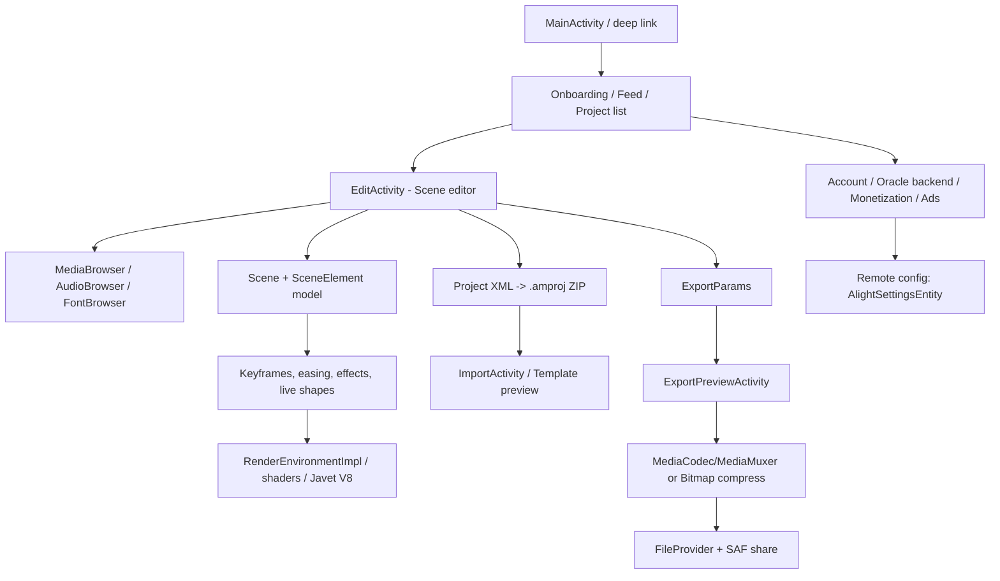
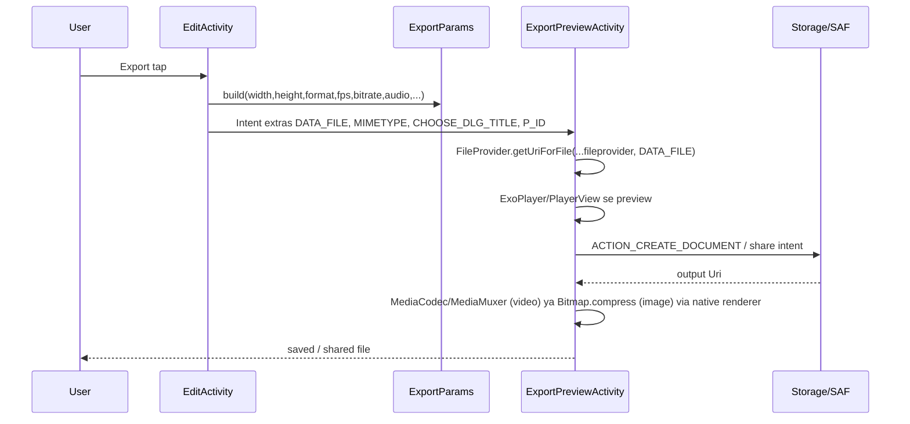

# ANALYSIS.md — Reverse engineering report

**Target:** `google_drive/base.apk` (Drive se download kiya gaya naya `base.apk`, upload 2026-11-25 ke baad)
**Goal:** Reference app ka end-to-end behaviour samajhna, taaki clean-room apna app banaya ja sake.
**Method:** Static analysis only (unzip + androguard 4.1.4 + DAD decompiler + strings). Dynamic/emulator analysis nahi kiya; backend ko call nahi kiya.

---

## 1. Identity aur build facts

| Field | Value |
| --- | --- |
| File | `google_drive/base.apk` |
| Size | 97,088,510 bytes (~93 MiB) |
| SHA-256 | `ce0346c7162e3ddd43702eeb132d0a966cb82efd845e902ed8a7396401ca5a75` |
| Package | `com.alightcreative.motion` |
| App label | **After Motion Z+** |
| Version | `10.0.1` (`versionCode=9999999` — abnormally high, repackaging marker) |
| minSdk / targetSdk / compileSdk | 24 / 36 / 36 |
| Application class | `com.pairip.application.Application` (Pairip protection layer) |
| Flags | `allowBackup=true`, `largeHeap=true`, `isGame=true`, `extractNativeLibs=true`, `supportsRtl=true` |
| DEX | 11 files, 320,872 methods total (18,659 `native`, 302,213 with bytecode) |
| App-related classes | 3,389 (3,307 me readable bytecode; baaki native/protected) |

Evidence: `research/manifest_report.txt`, `research/manifest_detail.txt`, `research/dex_summary.txt`, `research/build_all.py`.

> **Important:** ye stock Play Store build nahi lagta. App name badla hua hai (“After Motion Z+”), versionCode 9999999 hai, aur andar `ApkSignatureKillerEx` reference aur mod-library strings milti hain. Isliye main **licensing / device-verification / DRM-bypass** wale hisse ko deliberately analysis se bahar rakhta hoon — wo mere scope me nahi hai.

---

## 2. High-level: app kya hai?

Ek ** motion-graphics / video-editing app** hai — Alight Motion style:

- multi-layer scene/time-line editor
- keyframe-based animation with easing aur Bezier/spline curves
- text, shapes, drawing, camera, audio, nested scenes, solid/gradient/image/video fills
- 1,100+ built-in visual-effect presets (`.ta` files)
- image (PNG/JPEG/WebP/GIF) aur video (MP4/3GPP/WebM/M4A) export
- cloud features: templates, project share links, account, subscriptions, feed
- heavy monetization + ads + remote-config feature flags
- JS-driven UI layer (Injet) aur Javet V8 engine for scripts/effects

---

## 3. Manifest inventory

**Permissions: 26.** Mujhse milne wale:

- Network/ads: `INTERNET`, `ACCESS_NETWORK_STATE`, `ACCESS_WIFI_STATE`, `ACCESS_ADSERVICES_*`, `com.google.android.gms.permission.AD_ID`
- Media/storage: `READ_MEDIA_IMAGES/VIDEO/AUDIO`, `READ_MEDIA_VISUAL_USER_SELECTED`, `READ_EXTERNAL_STORAGE`, `WRITE_EXTERNAL_STORAGE`
- Notifications/foreground: `POST_NOTIFICATIONS`, `FOREGROUND_SERVICE`, `VIBRATE`, `WAKE_LOCK`
- Billing/licensing: `com.android.vending.BILLING`, `com.android.vending.CHECK_LICENSE`
- Billing/analytics SDK: `QUERY_ALL_PACKAGES`, FCM receive, install-referrer, AppLovin AppHub, dynamic-receiver permission

**Components:** 91 activities, 14 services, 14 receivers, 8 providers.

App ke khud ke important components:

| Component | Role / evidence |
| --- | --- |
| `MainActivity` | Launcher (`MAIN`/`LAUNCHER`), `singleTask`, portrait. Deep links: `https/http://alight.to`, `alightcreative.page.link`, dynamic link hosts, path `/am/share/u/`, Firebase auth links. `onCreate/onNewIntent` native hain. |
| `EditActivity` | Core editor, 618 methods, parent `MainActivity`; `onRequestPermissionsResult`, `onSaveInstanceState`. |
| `ImportActivity` | `alightmotion://` scheme, `ACTION_VIEW`/`ACTION_SEND` for `.amproj`, `file`/`content` URIs, `application/zip`, `application/xml`, `text/xml`. |
| `ExportPreviewActivity` | Export preview + share sheet; intent extras `DATA_FILE`, `MIMETYPE`, `CHOOSE_DLG_TITLE`, `P_ID`, `TEMPLATE_LINK_DATA`, `TEMPLATE_QR_DATA`. |
| `MediaBrowser`, `AudioBrowserActivity`, `FontBrowserActivity`, `EffectBrowserActivity` | Asset pickers. |
| `SaveToStorageActivity`, `ColorPickerActivity`, `SettingsActivity`, `MyAccountActivity`, `ManageAccountActivity`, `AboutActivity`, `DevSettingsActivity` | Utility/account screens. |
| `TemplateImportPreviewActivity`, `PresetPreviewActivity`, `OnboardingActivity`, `TutorialActivity`, `PaywallActivity`, `StackedOffersPaywallActivity`, `CreatorProgram*`, `QAsActivity` | Content/monetization flows. |
| `FileProvider` | Authority `com.alightcreative.app.motion.fileprovider` — exported files share karne ke liye. |
| `ChooserResultReceiver` | Share/SAF result receiver. |

Manifest me kaafi third-party activities/services/receivers bhi hain (AdMob, AppLovin MAX, Meta, Vungle, Fyber/InMobi, Firebase, WorkManager, Facebook login).

---

## 4. Architecture (observed)

### Technology stack inside

- **UI:** Jetpack Compose (`androidx.compose.*`), traditional XML views bhi hain (ConstraintLayout, RecyclerView)
- **DI/Kotlin:** Koin-like `org.koin`? decompiled me `oD.A.hUw` pattern; Kotlin coroutines, Flow
- **Local DB:** Android Room (`AlightSettingsEntity`, `PicoEventDatabase`, `MultiInstanceInvalidationService`)
- **Async/background:** WorkManager (`SystemJobService`, `SystemForegroundService`, constraint proxies)
- **Networking:** Retrofit + OkHttp + Moshi (JSON adapters decompiled me clearly visible)
- **Media:** AndroidX Media3/ExoPlayer, MediaCodec/MediaMuxer, OpenGL/ES shaders, GIF lib
- **JS engine:** **Javet V8** (`libjavet-v8-android.v.4.1.4.so`) — `crisper/mnt.js`, live-shape scripts, Injet web UI
- **Cloud:** Firebase Auth UI, Firestore, Cloud Functions, Analytics, Crashlytics, Remote Config, App Check, FCM
- **Billing:** Google Play Billing + Bending Spoons `monopoly`/`oracle`
- **Ads:** AdMob + AppLovin MAX + Meta Audience Network + Vungle + Fyber/InMobi + others

---

## 5. Native layer aur assets

### Native libs (arm64-v8a, armeabi-v7a)

| Lib | Inference |
| --- | --- |
| `libjavet-v8-android.v.4.1.4.so` (~35 MB arm64) | Embedded V8 JS engine — effects/live-shape scripts aur web UI. |
| `libx.so` (~7.9 MB arm64) | Pairip/protected-method VM: andar app ke native method signatures (MainActivity, EditActivity, SceneElement etc.) milti hain. Entry classes ka bytecode yahi implement karta hai. |
| `libsatriyaid.so`, `libsatriyaid2.so`, `libstrxid.so` | Device-ID / mod overlay libraries. `libsatriyaid.so` me “Device Verification”, payment aur “Permanently Hide” jaise UI strings hain — ye **mod-specific** hain, app ke asli product flow ka hissa nahi. |
| `libalight-giflib.so` | GIF encode/decode. |
| `libcrashlytics-common.so` | Crash reporting. |

### Assets

- `assets/effects/` — **1,107** `.ta` effect preset files
- `assets/shaders/`, `shapes/`, `lottie/`, `samplemedia/`, `fontthumb/`, `licenses/`, `protected_by_np/`
- `assets/data/device_capabilities.csv` — device → max resolution / max layers table (e.g. `0010813,4,3,-1,-1,1080`)
- `assets/crisper/mnt.js`, `assets/high_qual_coeffs.txt` (8.6 MB) — scripting/filter data
- `assets/injet/dist.zip` — Vite-built JS web app (`index.html`, `js/index.js` ~2 MB, assets with header video/images) used for paywalls/dynamic UI
- `assets/bin/SignKey*.bks`, `dp.*.so.dat` — protection/signature material (mod-related; ignore for blueprint)

---

## 6. Core data model (decompiled se directly)

### `Scene` (`com.alightcreative.app.motion.scene.Scene`)

`title`, `type`, `width`, `height`, `exportWidth`, `exportHeight`, `formatVersion`, `framesPerHundredSeconds`, `totalTime`, `elements: List<SceneElement>`, `background: SolidColor`, `bookmarks`, `mediaInfo`, `thumbnailTime`, `templateLink`, `precompose`, `reTimingMethod/InMark/OutMark`, `reTimingAdaptFrameRate`, `modifiedTime`.

### `SceneElement`

`id`, `type`, `startTime/endTime`, `inTime/outTime`, `src`, `fillImage`, `fillVideo`, `transform: KeyableTransform`, `speedMap`, `text: StyledText`, `drawing`, `nestedScene`, `parent`, `blendingMode`, `borders`, `stroke`, `dropShadow`, `cameraProperties`, `fillGradient/fillType`, `mediaFillMode`, `liveShape`, `presetId`, `templatePPId`, `visualEffects` + `visualEffectOrder`, `userElementParamValues`, `tag`, `label`, `loop`, `hidden`.

`SceneElementType`: `Audio`, `Camera`, `Drawing`, `NullObject`, `Scene`, `Shape`, `Text` (media types ke aur implementations alag packages me hain).

### Animation primitives

- `Keyable`, `KeyableTransform`, `KeyableEdgeDecoration`, `KeyableCompoundCubicBSpline`
- Easing classes: `BounceEasing`, `CubicBezierEasing`, `CyclicEasing`, `ElasticEasing`, `ElasticStepEasing`, `RandomEasing`, `StepEasing`
- Geometry: `CompoundCubicBSpline`, `CubicBSpline`, `GeometryKt`, `SceneKt`
- Rendering: `RenderEnvironmentImpl`, `SceneElementRenderingKt`, `SceneThumbnailMaker`, `TextureCropMode`, shaders in assets

### `ExportParams`

`startFrame`, `endFrame`, `width`, `height`, `format`, `video`, `audio`, `videoMime`, `audioMime`, `videoBitrate`, `audioBitrate`, `audioSampleRate`, `audioChannelCount`, `fphs`, `imageQuality`, `opaque`, `idrInterval`, `startOfNoWatermarkPeriod`, `durationOfNoWatermarkPeriod`.

`ExportFormat` enum: `GIF`, `JPEG_PLAIN`, `JPEG_ZIP`, `M4A`, `PNG_PLAIN`, `PNG_ZIP`, `VIDEO_3GPP`, `VIDEO_MPEG4`, `VIDEO_WEBM`, `WEBP_PLAIN`, `WEBP_ZIP`.

### Project package DTOs

- `ProjectInfo` — `isTemplate()`, `isXml()`
- `SharedProjectPackageInfo` — `amPackageId`, `amPackageVersion`, `amVersionCode`, `amVersionString`, `amPlatform`, `title`, `shortLink`, `size`, `shareDate`, `projects`, `requiredEffects`, `maxFFVer`, thumbnail URLs (`tiny/small/med/large`), `unavailableNotice`
- `RegisterAMProjectPackageRequest` — `packageInfo`, `packageId`, `acctTestMode`
- `ProjectPackageIDResponse` — `result`, `packageId`, `errorCode/Message`, `freeUserMaxDownloadSize`
- `AlightLinkMetadataResponse` — `info`, `download`, `liteVersionAvailable`, `freeUserMaxDownloadSize`, `message`, `error`
- `RequestProjectDownloadRequest` — `uid`, `pid`, `platform`, `appBuild`, `liteVersion`, `acctTestMode`
- `RequestProjectDownloadResponse` — `result`, `downloadUri`

Project format: XML serialization via `XmlSerializer`/`XmlPullParser` (`SceneElement` methods accept these); packaged as ZIP with `.amproj` extension.

### Remote config `AlightSettingsEntity` (feature flags)

`landingTab`, `navigationBar`, `defaultResolutionProjectCreation`, `exportMenuItems`, `exportMenuItemsMultishare`, `exportedVideoAttachment`, `isInjetEnabled`, `injetVersioningFileUrl`, `isNewTemplatesExperienceEnabled`, `newWatermarkDesign`, `watermarkV2Enabled`, `templateExportToggleEnabled`, `templateRevampedImportFlowEnabled`, `xmlImportEnabled`, `tryItFirstAvailable`, `onboardingShowCards/SkipButton`, `koreanOnboardingFlowEnabled`, `creatorProgramEnabled/Standby`, `creatorRankingEnabled/Standby`, `creatorRewardList`, `paywall*` flags, `stackedIntroOffers`, `adsExperience`, `adMediationProvider`, `admob*AdUnitId`, `shareEligibilityWatchAds*`, `profilingEvents`, `technicalEvents`, `crisperScript` etc.

### Persisted preferences (`com.alightcreative.app.motion.persist`)

`projectPresetFps`, `newProjectAspect`, `projectPresetRes`, `defaultLayerDuration`, `mediaBrowserMode`, `audioBrowserMode`, `sceneBrowserMode`, `colorSelector`, `drawingTool`, `drawingColor`, `drawingStrokeWidth`, `maxRes`, `maxResWithVideo`, `maxLayers720/1080/1440/2160`, `deviceCapsCheck*`, `licenseCacheVersion`, `licenseInfo`, `skuList`, `accountInfoCacheDate`, `recentlyUsedMedia/Audios`, `demoMode`, `acctTestMode`, `apkInvalid`, `lastApkValidation`, `mandatoryUpdateVer`.

---

## 7. Network / backend map

Observed URLs and paths (strings + decompiled):

| Purpose | Endpoint |
| --- | --- |
| Static app data | `https://alightcreative.com/appdata/am/` |
| Effect recommendations | `.../elements/recommendations.json` |
| Tutorial data | `.../tutorial-data/android.json` |
| Elements embed | `https://alightcreative.com/elements?embed=true` |
| Font thumbs | `https://alight-fonts.firebaseapp.com/appdata/fontthumbs/20180905A/webp/` |
| Account/subscription backend | `https://alightmotionandroid.oracle.bendingspoonsapps.com/` |
| Setup endpoint | `/v1/public/setup/{bspId}` |
| Public templates | `/v1/templates/public-templates/` |
| Analytics v2 | `/v2/public/apps/{bspId}/events` |
| Analytics v4 | `/v4/events` |
| Pico events | `https://api.pico.bendingspoonsapps.com`, `https://api.picox.bendingspoons.com/v1/events` |
| SpiderSense | `https://spidersense.bendingspoons.com` |
| Dynamic config | `https://builds.mosaic-matrix.bendingspoons.com/AlightMotionAndroid/versioning.json` |
| Firebase Functions template | `https://%1$s-%2$s.cloudfunctions.net/%3$s` |
| XML validation callable | Firebase function `validateProjectPackageXML` |
| Share deep links | `https://alight.to`, `https://alightcreative.page.link`, `https://alightcreative.com/am/share/u/`, `alightmotion://` |
| Firebase Auth links | `https://alight-creative.firebaseapp.com/__/auth/links`, `/alight-creative-staging.firebaseapp.com/...` |

Full URL list: `analysis/urls_all.txt`; filtered strings: `analysis/strings_clean.txt`.

---

## 8. Step-by-step workflows (what → how)

### 8.1 Launch → home

1. `MainActivity` launcher se open hota hai (`singleTask`, portrait).
2. `onCreate`/`onNewIntent` deep-link URI handle karte hain (native code, direct decompile nahi hua — inferred from manifest filters + method signatures).
3. Persisted flags (`firstAppExec`, onboarding flags) aur remote config (`landingTab`, `navigationBar`, `shouldHideHomepageUntilFirstHook`) ke hisaab se onboarding/tutorial/home decide hota hai.
4. Home me project list, templates, feed aur account/paywall entry points hain.

### 8.2 New project → edit

1. User resolution/aspect/fps select karta hai (`projectPresetRes`, `newProjectAspect`, `projectPresetFps`).
2. Device capabilities CSV se max resolution/layers limit milti hai (`device_capabilities.csv`, `maxLayers*`, `maxRes`).
3. Naya `Scene` banta hai: width/height, framesPerHundredSeconds, totalTime, empty elements, background.
4. `EditActivity` editor kholta hai. `TimelineLayoutManager` timeline scroll/zoom aur drag handle karta hai; `ColorPickerWidget`, `ValueSpinner`, `AlightSlider` property controls hain.

### 8.3 Add media / elements

1. `MediaBrowser`/`AudioBrowserActivity`/`FontBrowserActivity` se media pick hota hai; permissions `READ_MEDIA_*` runtime request `onRequestPermissionsResult` me handle.
2. Har picked asset se `SceneElement` banta hai (type Shape/Text/Audio/Camera/Drawing/Scene/NullObject).
3. Element properties: `KeyableTransform` (position/scale/rotation/opacity over time), `speedMap`, `fill*`, `stroke`, `borders`, `dropShadow`, `blendingMode`, `visualEffects`.
4. Keyframes easing classes se interpolate hote hain (Bezier, elastic, bounce, step, random etc.); splines path animation ke liye.
5. Effects 1,107 `.ta` preset files se load hote hain; live shapes/scripts Javet V8 se execute hote hain.
6. Rendering `RenderEnvironmentImpl` + shaders + Media3/ExoPlayer preview ke through hota hai.

### 8.4 Save / import project

1. Scene tree `XmlSerializer` se XML me likhi jaati hai, ZIP package ke saath `.amproj` banta hai.
2. `ImportActivity` incoming `alightmotion://`, `ACTION_VIEW`, `ACTION_SEND`, `.amproj`, `file://`, `content://`, zip/xml handle karta hai.
3. `onCreate` URI aur MIME nikal kar ViewModel (`CU`) ko deta hai; ViewModel Compose UI dikhati hai.
4. XML validate karne ke liye Firebase Cloud Function `validateProjectPackageXML` call hoti hai.
5. `TemplateImportPreviewActivity` metadata, thumbnails, `requiredEffects`, `freeUserMaxDownloadSize` dikhakar confirm leti hai, phir scene me merge karti hai.
6. Share link flow: `RegisterAMProjectPackageRequest` backend me package register karta hai; response me `packageId` milta hai; link `alightcreative.com/am/share/u/{id}`.
7. Download flow: `RequestProjectDownloadRequest(uid, pid, platform, appBuild, liteVersion, acctTestMode)` → `downloadUri` → `.amproj` fetch.

### 8.5 Export

- Formats: MP4/3GPP/WebM/M4A (MediaCodec + MediaMuxer; `videoMime`, `audioMime`, `idrInterval`), PNG/JPEG/WebP/GIF (bitmap compress / GIF lib).
- Watermark controls `startOfNoWatermarkPeriod` aur `durationOfNoWatermarkPeriod` se — entitlement/license se juda hai.

### 8.6 Account, paid features aur ads

- Firebase UI Auth + Oracle backend (`Settings`, `User`, `Products`, `Subscription`, `NonConsumable`, `Consumable`, `IdentityToken` DTOs).
- Play Billing + Bending Spoons `monopoly` purchase verification; `com.alightcreative.account.A` me `IAP: verifyPurchases`, `updatePurchasesFromGooglePlay`, license benefits compute, cache refresh.
- `PaywallActivity`, `StackedOffersPaywallActivity`, `PaywallCards*`, creator program/ranking/redeem flows.
- Ads: remote config se `adMediationProvider`, `adsExperience`, `admobInterstitialAdUnitId`, `admobRewardedAdUnitId`, `shareEligibilityWatchAdsEnabled`; multiple SDKs initialize via `AppLovinInitProvider`, `FacebookInitProvider`, `MobileAdsInitProvider`.
- Injet: `assets/injet/dist.zip` web UI + `AndroidBridge` me `nativeFunctions`, modules `MonetizationModule`, `AnalyticsModule`, `NativeStorageModule`, `WolfModule`.

### 8.7 Background

WorkManager jobs, FCM notifications, Pico analytics event upload (`/v2/public/apps/{bspId}/events`, `/v4/events`), Crashlytics, force updater (`ForceUpdateActivity`, `mandatoryUpdateVer`).

---

## 9. Obfuscation / protection notes (deliberately limited)

- Entry classes (`MainActivity`, kai `activities.*`) ke methods `ACC_NATIVE` hain; unka implementation `libx.so` (Pairip VM) me hai. Isliye exact navigation code directly readable nahi.
- `com.pairip.application.Application`, `apkInvalid`, `lastApkValidation`, `device caps check` flags protection ka hissa hain.
- `libsatriyaid.so` me mod/overlay UI strings aur `ApkSignatureKillerEx` reference mila — ye third-party patch ka nishaan hai.
- **Main is hisse ko reverse nahi kar raha** (license bypass, device verification, signature killer). Tumhare apne app ke blueprint me ye cheezein bilkul nahi aayengi.

---

## 10. Limitations

- Dynamic/emulator analysis nahi kiya (request bhi nahi tha).
- Deep-link payload handling aur kuch business rules native VM me hain — inference manifest, strings, method signatures aur non-native DTOs se kiya gaya hai.
- Backend ko real requests nahi bheje gaye; endpoint list static strings se hai.
- Decompiled Java DAD se approximate hai (variable names `v8_12` etc.), par class/field/method names reliable hain.

---

## 11. Evidence index

| File | Contents |
| --- | --- |
| `research/manifest_report.txt` | package, versions, 26 permissions, components |
| `research/manifest_detail.txt` | application attrs, intent filters, deep links, meta-data |
| `research/dex_summary.txt` | 11 DEX counts |
| `research/build_all.py` | native vs code method counts |
| `research/class_method_index.tsv` | 22,273 app methods (class, descriptor, has_code, dex) — class inventory |
| `research/strings_clean.txt`, `research/urls_all.txt` | filtered strings, 211 URLs/endpoints |
| `research/decompiled/*.java` | 72 decompiled classes (Scene, ExportParams, ImportActivity, DTOs, SDK models, effects, account, onboarding) |
| `research/strings_index.md` | auto-categorized strings: URLs, endpoints, intents, MIME, pref keys |
| `research/class_method_index.tsv` | 22,273 app methods with class, descriptor, has_code, dex |
| `analysis/unpacked/` | raw APK contents (git-ignored, locally regenerated) |

---

## 12. Next step

Is `ANALYSIS.md` ke aadhar par `BLUEPRINT.md` ke `TBD` fields fill karne hain — feature matrix, module structure, data schema, API contract, UX flow, aur safe implementation plan. Ye clean-room hoga: behaviour copy, code/assets nahi.

---

## 13. Quick-query guide (future questions ke liye)

| Tum puchho | Main yahan se turat dekhunga |
| --- | --- |
| "Kaunsa class X karta hai?" | `research/class_method_index.tsv` me grep karo |
| "Kaunsa endpoint/URL hai?" | `research/urls_all.txt` + `research/strings_index.md` |
| "Kaunsa permission/intent filter?" | `research/manifest_report.txt`, `research/manifest_detail.txt` |
| "Scene/export/import ka code?" | `research/decompiled/<class>.java` |
| "Kaunsa pref key?" | `research/strings_index.md` → SharedPreferences keys |
| "Kaunsi effect/script files?" | `analysis/unpacked/assets/effects/`, `assets/crisper/`, `assets/injet/` |
| "Kaunsi native lib?" | `analysis/unpacked/lib/*` + strings |

> Note: `research/` Git me tracked hai (text reports), `analysis/unpacked/` aur `*.apk` git-ignored hain. Isliye future turn me bhi upar wale text indexes available rahenge; raw APK/large binaries ko zarurat padne par Drive se dobara download kar liya jayega.

---

## 14. Effects deep dive (extra)

**Assets:** `assets/effects/` me **1,107** `.ta` compiled effect definitions; saath me `assets/shaders/`, `assets/shapes/`, `assets/lottie/`, `assets/fontthumb/` hain.

### Loader

`com.alightcreative.app.motion.scene.visualeffect.VisualEffectKt`:
- `initVisualEffects(Context, String, ...)`, `initVisualEffectPresets(Context, String)`
- `loadVisualEffects(...)`, `loadVisualEffectPresets(...)`
- caches: `effectParamsCache`, `loadedVisualEffects`, `loadedVisualEffectPresets`
- `CountDownLatch visualEffectsLoaded` / `visualEffectPresetsLoaded` → async init, UI tab tab tak wait
- `presetLoadErrors` → corrupt/incompatible `.ta` ke liye error list
- `getEffectSig()` → effect bundle version/compat signature

> Note: in loader ke methods Pairip-protected `native` hain; signatures aur fields readable hain, andar ka parsing code `libx.so` me hai.

### `VisualEffect` (definition)

Fields: `id`, `name`, `desc`, `categoryId`, `categories`, `tags`, `type`, `parameters`, `passes`, `scripts`, `shaderGroups`, `packagedPresets`, `affinity`, `autoTransform`, `iterCount`, `iterParam`, `maxOverdraw`, `hasOverdaw`, `localizedStrings`, `thumbnail`, `backgroundImage`, `uri`, `deprecated`, `experimental`, `internal`.

`EffectType` enum: **`DRAWING`, `SHADER`, `TEXT`**.

`EffectAffinity.Type`: **`Animation`, `Freehand`, `Media`, `Stroke`, `Text`, `TransformAnimation`**; `Strength`: **`Recommended`, `Required`**. `affinityFor()` / `getAffinityTypes()` decide karte hain ki effect kis `SceneElement` par lag sakta hai.

### `EffectPreset` (ready-made settings)

Fields: `id`, `effectId`, `label`, `shortCode`, `properties: Map`, `timing`, `timescale`, `presetSource`, `parseErrors`.

`EffectPresetTiming` enum: **`Start`, `End`, `Split`, `Stretch`, `Extend`, `ExtendMatch`** — matlab preset ki relative timing ko layer ki actual duration me kaise map karna hai (`adjustForTiming`, `toLayerFraction`, `toPresetMillis`).

### Apply karne ka tareeqa

1. `SceneElement` me do cheezein: `visualEffects: Map` aur `visualEffectOrder: List` — kaunse effects, aur kis order me.
2. Har applied effect `KeyableVisualEffectRef` hota hai: `id`, `instanceId`, `parameters: Map`, `renderGroup`, `hidden`, `locallyApplied`, `disabledRenderGroups`.
3. Parameter value `KeyableUserParameterValue` me wrap hoti hai: `float`, `int`, `Uri`, `KeyableFloat`, `KeyableVector2D/3D/4D`, `KeyableQuaternion`, `KeyableSolidColor` — yani parameters bhi time par keyframe kar sakte hain.
4. `adjustForTiming()` preset properties ko layer timing ke hisaab se rescale karta hai.
5. Render time par effect ke `passes` + `scripts` + `shaderGroups` → `RenderEnvironmentImpl` → shaders → preview/export. `getHasWarpEffects()` batata hai ki geometry warp hai ya nahi.

### Live shapes (script-based effect)

`com.alightcreative.app.motion.scene.liveshape.LiveShapeScriptKt`:
- Javet **V8Runtime** me JS chalaata hai (`V8ValueArray`, `V8ValueObject`)
- caches: `scriptEnvCache`, `defaultHandlesCache`, `shapeDefaultOutlineCache`, `outlineCache = LruCache(128)`
- JS result se `CubicBSpline` / `CompoundCubicBSpline` banata hai (`p`, `closed`, `in`/`out` handle fields)
- shape outline = handle positions se computed spline; keyframes handle positions par lagte hain

### Blueprint takeaway

Clean-room version me effect ko **data-driven plugin** ki tarah rakhna: `{id, type, parameter schema, passes/shader refs, presets, affinity}` + alag renderer. Preset timing ko layer duration se map karne wala `adjustForTiming` jaisa layer zaroori hai. `.ta` binaries ya shader code copy mat karna — apna effect registry banana.

---

## 15. Reference UI layout evidence (APK resource inspection)

APK ke `res/layout/*` XML decode karke exact screen skeleton confirm kiya gaya (resource IDs/names `research/res_public.xml`, `research/string_by_id.tsv`, decoded layouts `research/layouts/` me hain). Clean-room reimplementation me yehi structure/flow rakha gaya hai — assets/code copy nahi kiye gaye.

### Launch / project list (`activity_home_screen.xml`, `activity_project_list_main.xml`)

- Root `DrawerLayout`; header `ConstraintLayout` **57dp**, bottom tab space **72dp**.
- Header: left 50dp hamburger, centered logo, right 40dp account/profile + tutorial buttons.
- `ComposeView` content area header ke niche, bottom tab space se upar.
- Navigation drawer: `NavigationView` with menu `project_list_sidemenu.xml` → Settings, About, Open source libraries, My account, Tutorial, Privacy policy, Terms of service.
- Project list header **140dp**: centered logo, left/right 45dp buttons; bottom me 3 equal tabs with icon + 9sp label:
  - `tab_bar_home` → **Home**
  - `tab_bar_projects` → **Projects**
  - `my_elements` → **My Elements**
- 2dp selected-tab underline, `ViewPager` white content area, bottom-right add button (`ac_ic_add_element`), multi-select toolbar with cancel/delete/share/menu.

### Create project (`create_project_fragment.xml`)

- Full-screen panel; top segmented control **Project / Element**.
- "Project title" field; aspect-ratio row: **16:9, 9:16, 4:5, 1:1, 4:3, Custom**.
- Resolution block: width/height fields with link toggle; Frame rate dropdown; Background color dropdown; centered **Create Project** button; bottom close button.

### Editor (`activity_edit.xml` + includes)

- Top **42dp** navbar (`activity_edit_navbar.xml`): exit icon, editable project title, settings, share, group settings.
- Optional selection bar overlay **42dp** (`activity_edit_selectbar.xml`) for multi-select/align/group actions.
- Canvas `FrameLayout` between navbar and timeline, containing `SurfaceView`; right-side vertical tool rail **50dp** with preview/grid/camera/zoom buttons + zoom controls (weight 1.8).
- Info bar **46dp** (`activity_edit_infobar.xml`): keyframe position, offset, and 6 pairs of value labels.
- Play bar **46dp** (`activity_edit_playbar.xml`): undo, redo, previous frame, play, next frame, copy/paste menu, bookmark, panel close.
- Timeline `RecyclerViewEx` pinned to bottom: row height **28dp**, header width `timeline_header_width_expanded`, grip width `timeline_grip_width`, `TimelineLayoutManager`; bottom-left 40dp add-layer button and bottom-right overflow.
- Add-layer popup (`activity_edit_addpopup.xml`) items: **Media, Text, Shape, Camera, Audio, Freehand Drawing, Vector Drawing, Empty Group, Element / Project, Object / Element, Template**.
- Property panel `edit_panel_height` occupies bottom when a layer is selected; the 1,120-effect browser is a separate dialog/search surface.

### Interpretation for Ankit motion+

Home tab order, 140dp header, editor top bar/canvas rail/info/play/timeline stacking, 28dp timeline rows, and the 11-item Add menu are treated as the fixed Phase-A UI contract. Re-skinning or extras must preserve this arrangement until the user explicitly approves a redesign.
