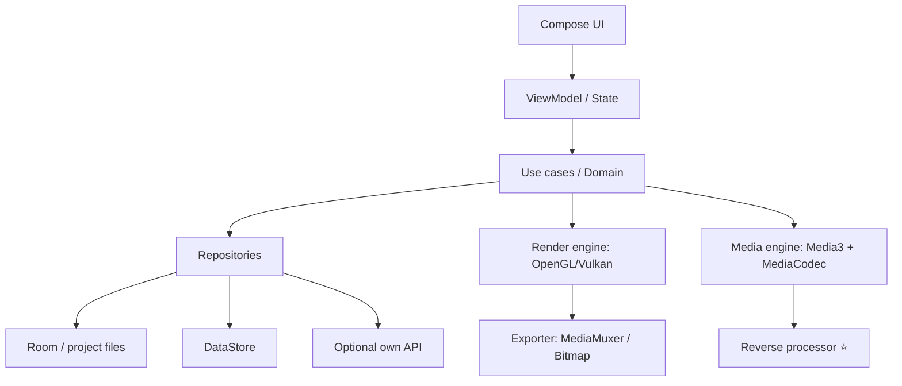
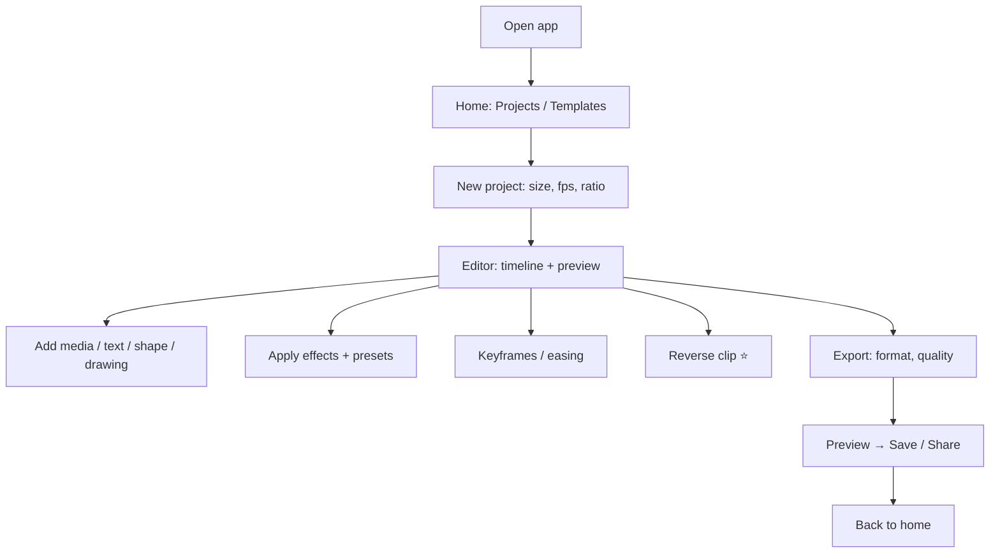

# Blueprint — Apna clean-room motion-graphics / video editor

> **Status:** Filled from `ANALYSIS.md` + user vision (2026-11-25).
> **Vision:** Reference jaisa editor, **lekin zyada effects** aur **naye features** — pehla confirmed naya feature: **video reverse**.
> **App name:** **Ankit motion+**
> **Rule:** behaviour se seekhna hai; code, `.ta` assets, shaders, branding copy nahi.
> **IMPORTANT:** Implementation **abhi start nahi** — pehle check build, uske baad paid version. Ye sirf blueprint hai.

## 0. Ground rules

- Reference app ka **behaviour** samajha, uska code/assets/branding **copy nahi** karna.
- Clean-room implementation: apna data model, apna effect registry, apna renderer.
- No malware, no unauthorized access, no license/DRM bypass, no mod/device-verification tricks.
- Reference ke backend endpoints reuse nahi karenge; apna local-first design.

---

## 1. Inputs / assumptions

| Input | Status |
| --- | --- |
| Reference APK | ✅ Analyzed (`ANALYSIS.md`) |
| Target stack | ✅ **Native Android — Kotlin + Jetpack Compose + OpenGL/Vulkan + Media3/MediaCodec** (tumne language choose karne diya) |
| minSdk | 26 (reference 24 tha; 26 se media/codec APIs easy) |
| Backend | ✅ **Bilkul nahi** — no cloud, no account, no remote config. Pure local app. |
| App name / branding | ✅ **Ankit motion+** |
| MVP scope | **Check build**: core editor + effects + **video reverse** + export, local-only |
| Monetization | **Phase A:** free check build. **Phase B (baad me):** paid version. Abhi koi billing/ads nahi. |

---

## 2. Product definition

| Item | Value |
| --- | --- |
| Core purpose | Mobile motion-graphics + video editing: layers, keyframes, effects, export |
| Primary journey | Project banao → media add → layers/effects/keyframes → preview → export/share |
| Entry screen | Home: Projects, Templates, Media, Settings |
| Main actions | New project, import media, edit timeline, apply effects, reverse clip, export |
| Success state | Exported file saved/shared; project locally persisted |

### Tumhare differentiators ⭐

1. **Zyada effects** — reference ke 1,107 `.ta` presets se bhi upar jane ka extensible registry.
2. **Video reverse** — reference me ye feature nahi mila; humare me hoga.
3. **Aur naye features** — backlog (neeche feature matrix me “Backlog”).

### Release phases

| Phase | Kya | Status |
| --- | --- | --- |
| **A — Check build** | Local-only editor, zyada effects, video reverse, export. Check/testing ke liye. | ⏳ Abhi start nahi |
| **B — Paid version** | Same app + paid features/licensing, tumhare bataane par. | ⏳ Later |

---

## 3. Feature matrix

| # | Feature | Reference me | Hamare version me | Priority |
| --- | --- | --- | --- | --- |
| 1 | Project create (resolution/aspect/fps) | ✅ presets + device caps | ✅ apna preset system | Must |
| 2 | Media / audio / font browser | ✅ | ✅ | Must |
| 3 | Timeline + multi-layer editor | ✅ `TimelineLayoutManager` | ✅ apna timeline composable | Must |
| 4 | Keyframes + easing | ✅ bounce/elastic/bezier/step/random | ✅ same *behaviour*, apna code | Must |
| 5 | Element types | Shape, Text, Drawing, Audio, Camera, Scene, Null | ✅ same set + future: Sticker, 3D-layer | Must |
| 6 | Visual effects | 1,107 `.ta`, types DRAWING/SHADER/TEXT | ✅ **extensible registry**; MVP 80–120, long-term 1,200+ | Must ⭐ |
| 7 | Effect presets + timing | Start/End/Split/Stretch/Extend/ExtendMatch | ✅ same mapping logic (`adjustForTiming`) | Must |
| 8 | Live shapes / JS scripting | Javet V8 + splines | Phase 2 (optional; apna expression engine) | Nice |
| 9 | Project save/import | XML → `.amproj` ZIP | ✅ apna JSON/ZIP project format (apna schema) | Must |
| 10 | Export | MP4/3GPP/WebM/M4A, PNG/JPEG/WebP/GIF | ✅ initial MP4 + PNG/JPEG/GIF, baaki later | Must |
| 11 | Template share links | backend + download URI | ❌ Cloud nahi — sirf local file share (SAF) | Skip |
| 12 | Account / subscriptions | Firebase + Oracle + billing | ❌ Phase A me nahi; Phase B paid me | Later |
| 13 | Ads / remote config | multiple SDKs | ❌ Nahi | Skip |
| 14 | **Video reverse** | ❌ nahi mila | ✅ **decode → reverse frames → encode**, audio reverse | **Must ⭐** |
| 15 | **More effects** | 1,107 | 1,200+ registry target | ⭐ |
| 16 | Backlog: speed ramps, auto-captions, background removal, motion blur, HDR export | ❌/partial | Candidate | Backlog |

---

## 4. Proposed architecture



**Why:** UI, data aur render alag layers. Naye effects aur naye features (reverse jaise) sirf naye modules add karke aate hain, purana code todna nahi padta.

### Module map

```
app/                     entry, navigation, DI, theme
feature-home/            projects, templates, settings
feature-editor/          timeline, layers, inspector, keyframe editor
feature-media/           media/audio/font pickers
feature-export/          export options + preview + share
feature-reverse/         video/audio reverse UI + worker ⭐
core-model/              Scene, SceneElement, Keyable, EffectDefinition
core-effect/             effect registry, presets, parameter schema ⭐
core-render/             renderer, shader/plugin pipeline, frame cache
core-media/              decode/encode, ExoPlayer preview, codec helpers
core-database/           Room DAOs, project persistence
core-network/            optional own API client
core-ui/                 shared composables, theme, icons
```

---

## 5. Data model (apna, clean-room)

```kotlin
data class Scene(
  val id: String, val title: String,
  val width: Int, val height: Int,
  val fps: Int, val durationMs: Long,
  val elements: List<SceneElement>,
  val background: Color,
  val formatVersion: Int = 1
)

data class SceneElement(
  val id: Long,
  val type: ElementType,       // Shape/Text/Audio/Camera/Drawing/Scene/Sticker...
  val startMs: Long, val endMs: Long,
  val sourceUri: String?,
  val transform: KeyableTransform,
  val opacity: KeyableFloat,
  val effects: List<EffectInstance>,
  val extras: Map<String, KeyableValue>   // text, fill, speed, etc.
)

data class EffectDefinition(
  val id: String,
  val type: EffectType,        // DRAWING / SHADER / TEXT / SCRIPT
  val parameters: List<ParameterSchema>,
  val renderPasses: List<RenderPass>,
  val presets: List<EffectPreset>,
  val affinity: Set<ElementType>
)

data class EffectInstance(
  val definitionId: String,
  val instanceId: Long,
  val parameters: Map<String, KeyableValue>,
  val timing: PresetTiming,    // Start/End/Split/Stretch/Extend/ExtendMatch
  val enabled: Boolean,
  val renderGroup: Int
)

data class ReverseSettings(
  val reverseVideo: Boolean,   // ⭐
  val reverseAudio: Boolean,
  val preserveDuration: Boolean
)
```

**Storage:** apna JSON schema inside `.rve` ZIP project (reference ka `.amproj` format copy nahi).

---

## 6. Network / API contract

**Koi network nahi.** Ankit motion+ pure local app hoga:

- Koi cloud API nahi
- Koi account/login nahi
- Koi remote config nahi
- Koi analytics/ads SDK nahi
- Koi reference endpoint call nahi

Sab kuch device par: project files, effect registry, preview, export, share sheet (Android SAF).

---

## 7. UX flow



**Reverse flow specifically:**

1. Timeline me clip select → inspector me **Reverse** toggle.
2. Worker: `MediaExtractor` → `MediaCodec` decode → frames reverse order → `MediaCodec` encode → `MediaMuxer`.
3. Audio: PCM decode → samples reverse → re-encode.
4. Preview player reversed clip dikhaata hai; original non-destructive rehta hai (undo possible).

---

## 8. Permissions & device features

| Permission | Justification | Pattern |
| --- | --- | --- |
| `READ_MEDIA_IMAGES/VIDEO/AUDIO` | media import | runtime (Android 13+) |
| `READ_EXTERNAL_STORAGE` | legacy Android ≤12 | runtime |
| `POST_NOTIFICATIONS` | export complete notification | runtime |
| `FOREGROUND_SERVICE` | long export/reverse worker | manifest + foreground notification |

> `INTERNET` permission **nahi** lenge — kyunki cloud kuch nahi.

File sharing ke liye apna `FileProvider` authority (reference ka authority copy nahi).

---

## 9. Dependencies (chosen)

| Area | Choice |
| --- | --- |
| UI | Jetpack Compose, Material3 |
| DI | Hilt ya Koin |
| Local DB | Room |
| Preferences | DataStore |
| Media playback | AndroidX Media3 / ExoPlayer |
| Codec | MediaCodec + MediaMuxer (platform) |
| Rendering | OpenGL ES / Vulkan (apne shaders) |
| Async | Kotlin Coroutines + Flow |
| Serialization | Kotlinx Serialization |
| Image loading | Coil |
| Background | WorkManager |

> FFmpeg mobile library se bachna (license/size); reverse platform codecs se karenge.

---

## 10. Build order

1. **Skeleton** — project, navigation, theme, DI, module structure.
2. **Core model + persistence** — Scene/Element/Effect + `.rve` project save/load.
3. **Home + project create** — resolution/fps/ratio presets.
4. **Editor vertical slice** — preview + timeline + one layer type (Shape).
5. **Media import + Text + Image/Video layers**.
6. **Keyframes + easing** — transform/opacity animated.
7. **Effect registry + first 20 effects** — shader plugin interface, preset timing.
8. **Scale effects** — 80–120 MVP, then 1,200+ registry pipeline.
9. **Video reverse ⭐** — separate `feature-reverse` worker + UI.
10. **Export** — MP4 + PNG/JPEG/GIF, share sheet.
11. **Import/share project** — apna `.rve` format + local share sheet.
12. **Polish** — empty/error/loading states, tests, accessibility, release signing.
13. **Phase A complete → check** — tumhare testing ke baad hi Phase B (paid) par baat.

---

## 11. Quality checklist

- [ ] No copied code/assets/shaders/branding
- [ ] No reference backend calls
- [ ] Least-privilege permissions
- [ ] Non-destructive editing (reverse/effects reversible)
- [ ] Long-video reverse memory limit + disk fallback
- [ ] Loading/empty/error states
- [ ] Unit tests for timing, keyframe interpolation, reverse frame order
- [ ] Smoke UI test for editor → export
- [ ] Release signing + ProGuard/R8

---

## 12. Decisions ✅

| Sawaal | Final answer |
| --- | --- |
| App name | **Ankit motion+** |
| Stack | **Kotlin native + Compose** (maine choose kiya) |
| Cloud | **Bilkul nahi** — local-only |
| Pehle kya? | **Check build** (free), uske baad paid version |
| Effects | MVP 80–120, registry extensible, long-term 1,200+ target |
| Reverse | Video + audio dono (non-destructive) |
| UI (abhi) | **Reference jaisa layout/flow** — check build me same feel; re-skin baad me |
| Start? | **Abhi nahi** — sirf planning/report ready hai |

> Jab tum bologe “ab shuru kar”, tabhi Phase A ka pehla slice banega. Tab tak code likha nahi jayega.

---

## 13. UI direction (final for Phase A)

- **Phase A — check build:** UI ka **structure/layout/flow reference jaisa** rakhenge:
  - Home: Projects / Templates / Media / Settings type tabs
  - Editor: upar preview, side me layers, neeche multi-track timeline, inspector panel
  - Import/export dialogs aur controls same arrangement
  - Timeline gestures, keyframe diamonds, effect browser ka pattern same
- **Phase B — baad me:** naya visual identity / re-skin / apni branding.
- **Clean-room limit:** layout aur interaction pattern same, par **reference ke screenshots, icons, fonts, colors exact copy nahi**. Sab apne assets se dobara banayenge; app name **Ankit motion+** hoga.
- Image mockup options tumne skip kiye — koi image file save nahi hui, aur abhi iski zarurat nahi.
